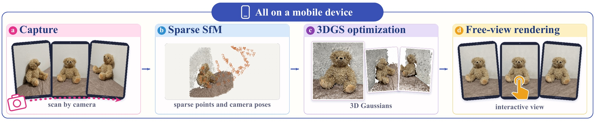

<h1 align="center">Cross3DGS: Unified Vulkan-Based 3D Gaussian Splatting Training from Workstations to Mobile Devices</h1>

<p align="center">
  Hiroyuki Sato, Yusuke Takimoto
</p>

<p align="center">
  IEEE/CVF Winter Conference on Applications of Computer Vision (WACV 2027),
  <a href="https://eof-workshop.github.io/">Workshop on Eyes of the Future (EOF)</a>
</p>

<p align="center">
  <a href="https://unclearness.github.io/cross3dgs/"></a>
  <a href="https://arxiv.org/abs/2611.22240"></a>
  <a href="https://github.com/unclearness/cross3dgs"></a>
</p>

<p align="center">
  
</p>

This is the official implementation of the WACV 2027 workshop paper.
**Cross3DGS** is a cross-vendor, cross-platform **3D Gaussian Splatting
trainer** built on **Vulkan compute**, with no CUDA. The same C++20 core
(Vulkan 1.1 / SPIR-V 1.3) trains on NVIDIA, AMD, and Intel GPUs on Windows and
Linux, on Apple GPUs through MoltenVK on macOS and iOS, and on Arm Mali and
Qualcomm Adreno GPUs on Android.

Each device gets its own **execution schedule**. A catalog of 256 schedules is
filtered by **feasibility rules** that read the device limits, the workload,
and known driver failures, and a **fixed preference order** picks one of the
remaining schedules. Every schedule computes the same optimizer update, and
the chosen schedule is recorded in each run's `bench.json`.

The repository also contains **Android and iOS apps** that run the whole
capture-to-view pipeline on the phone: AR capture, frame extraction, CPU
COLMAP structure from motion, 3DGS training, and a free-view viewer. The code
is dual-licensed under the GNU AGPL v3.0 or later and a commercial license
(see [License](#license)).

## BibTeX

```bibtex
@InProceedings{Sato_2027_WACV_Cross3DGS,
    author    = {Sato, Hiroyuki and Takimoto, Yusuke},
    title     = {Cross3DGS: Unified Vulkan-Based 3D Gaussian Splatting Training from Workstations to Mobile Devices},
    booktitle = {Proceedings of the IEEE/CVF Winter Conference on Applications of Computer Vision (WACV) Workshops},
    year      = {2027}
}
```

---

## Table of Contents

- [Requirements](#requirements)
- [Clone](#clone)
- [Build (desktop)](#build-desktop)
- [Environment variables](#environment-variables)
- [Datasets](#datasets)
- [Train and evaluate (desktop)](#train-and-evaluate-desktop)
- [Train and evaluate on Android](#train-and-evaluate-on-android)
- [Train and evaluate on iOS](#train-and-evaluate-on-ios)
- [Capture-to-view apps](#capture-to-view-apps)
- [Baselines](#baselines)
- [Layout](#layout)
- [License](#license)

## Requirements

### Desktop (Windows, Linux, macOS)

| Component | Notes |
|---|---|
| GPU and driver | Vulkan 1.1 compute support: any recent NVIDIA, AMD, or Intel driver; Apple GPUs through MoltenVK. |
| C++20 compiler | Visual Studio 2022 with the "Desktop development with C++" workload on Windows; GCC or Clang and Ninja on Linux; Xcode command line tools and Ninja on macOS. |
| Git, CMake >= 3.28 | |
| [LunarG Vulkan SDK](https://vulkan.lunarg.com/sdk/home) | Vulkan headers and loader, and the glslang/SPIRV-Tools libraries used for runtime shader compilation. 1.4.350.0 is tested; other 1.4 releases should work. Setup per platform is below. |
| Python 3.12, [uv](https://docs.astral.sh/uv/) | Dataset download, training runners, evaluation, and baselines under `scripts/`. |

Vulkan SDK setup:

- Windows: run the installer with its default components. CMake finds the
  SDK through `VULKAN_SDK`, or the newest `C:\VulkanSDK\<version>`.
- Linux: extract the tarball and `source <sdk>/setup-env.sh` before
  configuring (or extract it under `~/vulkan/<version>`, where CMake finds
  it without the variable). GLFW for the live viewer also needs the X11
  development packages, for example on Ubuntu:
  `sudo apt install build-essential ninja-build libx11-dev libxrandr-dev libxinerama-dev libxcursor-dev libxi-dev`.
- macOS: run the installer, which includes MoltenVK, and
  `source <sdk>/setup-env.sh`.
- Any platform: `-DCROSS_3DGS_VULKAN_SDK_DIR=<sdk root>` overrides the
  search.

### Android

| Component | Notes |
|---|---|
| Android Studio | Its bundled JDK 17 is used by Gradle. Set `JAVA_HOME` to Android Studio's `jbr` folder. |
| Android SDK | Platform 36, NDK 28.2.13676358, and CMake 3.31.6 from the SDK Manager. Set `ANDROID_HOME` to the SDK folder. |
| Device | arm64, Android 10 or newer, Vulkan 1.1, USB debugging enabled, and `adb` from the SDK platform tools. |
| [vcpkg](https://github.com/microsoft/vcpkg) | Capture-to-view app only: a bootstrapped vcpkg (`VCPKG_ROOT`) and the NDK in `ANDROID_NDK_HOME`, to build the SfM library. |

### iOS

| Component | Notes |
|---|---|
| Mac | Xcode, CMake, and the LunarG Vulkan SDK for macOS (for `MoltenVK.xcframework`). |
| Signing | An Apple ID signed in to Xcode, and an iPhone with Developer Mode enabled. |
| vcpkg, pkgconf | Capture-to-view app only: vcpkg and `brew install pkgconf`, to build the SfM library. |

## Clone

```sh
git clone --recursive https://github.com/unclearness/cross3dgs.git
cd cross3dgs
uv sync
```

## Build (desktop)

Windows (Visual Studio 2022, x64):

```powershell
cmake --preset msvc
cmake --build --preset release
ctest --preset release
```

Linux (Ninja, GCC):

```sh
cmake --preset linux
cmake --build --preset linux-release
ctest --preset linux-release
```

macOS (Ninja, AppleClang, MoltenVK; the live viewer is disabled):

```sh
cmake --preset macos
cmake --build --preset macos-release
ctest --preset macos-release
```

## Environment variables

| Variable | Effect |
|---|---|
| `CROSS3DGS_VK_DEVICE` | Device index or name substring that chooses the GPU. |
| `CROSS3DGS_VK_DEBUG` | `1` turns on the Vulkan validation layers. |

## Datasets

```sh
uv run python scripts/download_datasets.py mipnerf360              # data/360_v2/<scene>, about 12 GB
uv run python scripts/download_datasets.py mipnerf360 --scenes bicycle garden
uv run python scripts/download_datasets.py tandt_db                # data/tandt, data/deep_blending
```

Every eighth image (by sorted file name) is held out for evaluation.

## Train and evaluate (desktop)

`configs/standard_quality.json` is the standard-quality setting: 30,000
updates, SH degree 3, MCMC refinement up to one million Gaussians, and
L1 + 0.2 (1 - SSIM). `scripts/run_desktop.py` trains with it, scores the
held-out views with `scripts/common_evaluator.py` (PSNR, SSIM, LPIPS-AlexNet),
and writes `summary.json` with the per-run results and the per-scene medians:

```sh
# bicycle, three seeds
uv run python scripts/run_desktop.py --scenes bicycle \
    --seeds 20260815 20260816 20260817 --output out/desktop

# all 11 scenes (Mip-NeRF 360, Tanks and Temples, Deep Blending) against the baselines
uv run python scripts/run_desktop.py --scenes all \
    --methods cross3dgs vksplat brush \
    --seeds 20260815 20260816 20260817 --output out/desktop
```

Each scene uses its usual image folder (`images_4` for the outdoor
Mip-NeRF 360 scenes, `images_2` for the indoor ones, `images` for Tanks and
Temples and Deep Blending). Add `--cooldown` to wait for a cool GPU before each
run, `--iterations 200` for a quick smoke run, and `--no-lpips` to skip LPIPS
(LPIPS downloads torch on first use). The baselines need the checkouts
described under [Baselines](#baselines).

The trainer can also be run directly:

```powershell
.\build\tools\train_cli\Release\cross_3dgs_train.exe `
  --dataset-root data\360_v2 --scene bicycle --image-dir images_4 `
  --sparse-dir sparse\0 --train-iterations 30000 --sh-degree 3 `
  --ssim-weight 0.2 --density-strategy mcmc --gaussian-capacity 1000000 `
  --view-order random --adam-moments fp32 --full-image-ssim `
  --mcmc-clone-offset 0.5 --mcmc-gradient-sampling 1.5 `
  --benchmark-json out\bicycle\bench.json --evaluation-image-dir out\bicycle `
  --output-ply out\bicycle\model.ply
```

Add `--viewer --viewer-every 100` to watch the training target and the current
render side by side. `--help` lists every option. `model.ply` uses the standard
3DGS layout and opens in common splat viewers.

## Train and evaluate on Android

The training app bundles the seven Mip-NeRF 360 scenes, so download them
first. See [android/README.md](android/README.md) for requirements and details.

```powershell
uv run python scripts/download_datasets.py mipnerf360
.\android\gradlew.bat :app:assembleRelease
adb install -r android\app\build\outputs\apk\release\app-release.apk
uv run python scripts/benchmark_android.py --serial <adb serial> `
    --config configs/standard_quality.json --scene bicycle `
    --output out/android/bicycle --evaluate
```

## Train and evaluate on iOS

Build and install the iOS training app as described in
[ios/README.md](ios/README.md), then:

```sh
uv run python scripts/benchmark_ios.py --device <udid> \
    --config configs/standard_quality.json \
    --output out/ios/bicycle --evaluate
```

## Capture-to-view apps

The Android `:e2e` app and the iOS `cross3dgs_e2e_ios` app record a video with
ARCore or ARKit, extract frames, run COLMAP with the AR poses as priors, train
on the phone, and open a free-view viewer. See
[android/E2E_README.md](android/E2E_README.md) and
[ios/e2e/README.md](ios/e2e/README.md).

## Baselines

[VkSplat](https://github.com/harry7557558/vksplat) and
[Brush](https://github.com/ArthurBrussee/brush) run on the same images, split,
update count, capacity, SH degree, and SSIM weight, and their held-out renders
are scored by the same `scripts/common_evaluator.py`. `run_desktop.py --methods`
drives them through `scripts/benchmark_vksplat.py` and
`scripts/benchmark_brush.py`.

VkSplat (desktop):

```sh
git clone https://github.com/harry7557558/vksplat external/vksplat
git -C external/vksplat checkout e26c254
git -C external/vksplat apply ../../patches/vksplat_seed_adapter.patch
```

then build its Python module in place (on Windows, from a "x64 Native Tools
Command Prompt for VS"):

```sh
cd external/vksplat/vksplat
uv run --project ../../.. --with setuptools python setup.py build_ext --inplace
```

On macOS, prefix the build with `CFLAGS=-std=c++17`: VkSplat's `setup.py`
replaces the compile flags and drops the C++17 flag, which Apple clang does
not enable by default.

The patch exposes VkSplat's random seed to the benchmark script.

On macOS, the Vulkan loader hides MoltenVK from VkSplat, because the SDK's
`MoltenVK_icd.json` marks it as a portability driver and VkSplat does not
request portability enumeration (the run stops at
`vkEnumeratePhysicalDevices: Invalid instance`). VkSplat runs unmodified
against a copy of the manifest with that flag cleared. After
`source <sdk>/setup-env.sh`:

```sh
mkdir -p cache
python3 - <<'PY'
import json, os
sdk = os.environ["VULKAN_SDK"]
manifest = json.load(open(f"{sdk}/share/vulkan/icd.d/MoltenVK_icd.json"))
manifest["ICD"]["library_path"] = f"{sdk}/lib/libMoltenVK.dylib"
manifest["ICD"]["is_portability_driver"] = False
json.dump(manifest, open("cache/MoltenVK_icd_vksplat.json", "w"), indent=4)
PY
export VK_DRIVER_FILES=$PWD/cache/MoltenVK_icd_vksplat.json
```

Brush (desktop and Android):

```sh
git clone https://github.com/ArthurBrussee/brush cache/brush
git -C cache/brush checkout 3b80985
git -C cache/brush apply ../../patches/brush_android_benchmark.patch
git -C cache/brush apply ../../patches/brush_adapter_provenance.patch   # optional
cargo build --release --manifest-path cache/brush/Cargo.toml -p brush-cli
```

`brush_android_benchmark.patch` makes the Android app train on a dataset ZIP
pushed by the host and report its progress to logcat, and adds the
`--eval-initial-state-and-exit` option that the host uses to render a trained
PLY. `brush_adapter_provenance.patch` records the GPU adapter in the log.

For Brush on Android, build the app (Android NDK,
`rustup target add aarch64-linux-android`, `cargo install cargo-ndk`, and
`JAVA_HOME` and `ANDROID_HOME` set as for the Cross3DGS app; cargo-ndk finds
the NDK under `ANDROID_HOME`):

```sh
cd cache/brush/apps/brush-app
cargo ndk -t arm64-v8a -o app/src/main/jniLibs build --release
./gradlew assembleDebug
```

and run it from the repository root (`--apk` installs the APK first, as in
`benchmark_android.py`; leave it out to use the installed app):

```sh
uv run python scripts/benchmark_brush_android.py --serial <adb serial> \
    --apk cache/brush/apps/brush-app/app/build/outputs/apk/debug/app-debug.apk \
    --scene bicycle --seed 42 --output out/android_brush/bicycle --evaluate
```

## Layout

| Path | Contents |
|---|---|
| `libs/cross3dgs/` | 3DGS training and rendering, schedule catalog and selection |
| `libs/cross3dgs_gpu/` | Vulkan compute runtime (multi-pass programs, runtime GLSL compilation, device capabilities) |
| `libs/cross3dgs_sfm/` | CPU COLMAP sparse SfM shared by the Android and iOS capture apps |
| `tools/train_cli/` | Desktop training CLI with an optional live viewer |
| `tools/schedule_spec_cli/` | Writes the schedule catalog and policy, and the schedules feasible for a given device |
| `android/` | Android training app (`:app`) and capture-to-view app (`:e2e`) |
| `ios/` | iOS training app and capture-to-view app |
| `configs/` | Training presets |
| `scripts/` | Dataset download, training runners, evaluation, baselines |
| `patches/` | Small instrumentation patches for the baseline checkouts |
| `tests/` | CTest unit and GPU tests |

## License

Cross3DGS is free software: you can redistribute it and/or modify it under the
terms of the GNU Affero General Public License as published by the Free
Software Foundation, either version 3 of the License, or (at your option) any
later version (SPDX: `AGPL-3.0-or-later`); see [LICENSE](LICENSE). It is
distributed without any warranty.

**Commercial license.** The AGPL permits commercial use. The copyright holder
also offers Cross3DGS under a commercial license, granted only by a separate
written agreement, for example to distribute a proprietary product based on
it without meeting the AGPL's Corresponding Source requirements, or to run a
modified version as a network service without offering its source to the
users who interact with it; see [COMMERCIAL-LICENSE.md](COMMERCIAL-LICENSE.md).

**Exceptions.** Third-party components keep their own licenses, listed in
[THIRD_PARTY_NOTICES.md](THIRD_PARTY_NOTICES.md), with the license texts in
[LICENSES/](LICENSES/), under either license option. This includes the radix
sort adapted from VkSplat's radix-sort shaders (MIT, Copyright (c) 2024
jaesung-cs), the other code adapted from VkSplat (Apache-2.0), the patches
under `patches/` to Brush and VkSplat (Apache-2.0), and the vcpkg overlay
ports under `libs/cross3dgs_sfm/ports/` (MIT).

Copyright (c) 2026 Hiroyuki Sato.
